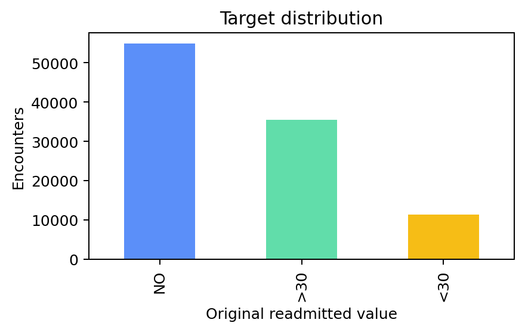
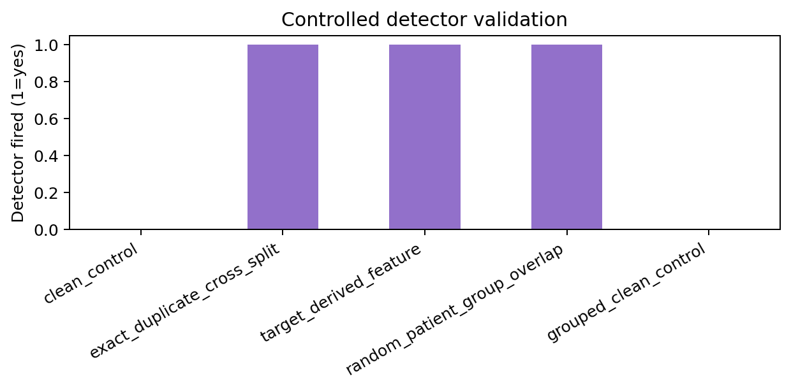

# Diabetes 130-US Hospitals real-world case study

## Scope

This is a reproducible LeakageLens case study on `diabetes+130-us+hospitals+for+years+1999-2008/diabetic_data.csv`. The original data were not modified or copied into experiment artifacts. Reports contain aggregate statistics only.

## Dataset verification

- Raw SHA-256: `0689e7ec031237dc63031b938805c48377748761a3b26acab621567afa24df97`
- File size: 19,159,383 bytes
- Raw shape: 101,766 rows × 50 source columns; the analysis adds one derived target column.
- Unique patients: 71,518; unique encounters: 101,766.
- Patients with multiple encounters: 16,773; maximum encounters for one patient: 40.
- Raw target counts: {'NO': 54864, '>30': 35545, '<30': 11357}. Positive rate for the operational target: 11.160%.
- Full duplicate rows: 0.

## Prediction task and policies

The primary binary target is 1 when `readmitted == '<30'`, and 0 for `'>30'` or `'NO'`. This is an operational 30-day readmission target; it does not claim that the two negative categories are clinically identical. Admission-time models exclude discharge disposition, length-of-stay/procedure/medication utilization, lab-result fields and medication/change fields whose availability depends on the hospitalization. Discharge-time models retain non-identifier source features. Both primary policies exclude `encounter_id` and `patient_nbr`; the latter is used only as the grouping variable.

## Split protocols

Ten seeds (42–51) were run for stratified random row splits and patient-grouped splits. Random splits had mean patient overlap of approximately 8,069 patients in the held-out partition; grouped splits had zero overlap for every seed. This is protocol sensitivity, not a causal estimate of leakage-induced inflation.

## Leakage findings

- Exact feature duplicates: none in the raw data.
- Near-duplicate detector: the implemented rounded/normalized row-equality candidate detector found candidates; this is a heuristic and not a general similarity score.
- Patient overlap: present in random splits and absent in grouped splits.
- Temporal validation: not defensible because the source columns contain no valid admission timestamp; no chronology was invented.
- Suspicious-feature warnings are treated as review signals, not proof of leakage.

## Controlled detector validation

Clean control was not flagged; injected exact cross-split duplication, target-derived feature naming, random patient overlap, and grouped-control separation produced the expected detector outcomes. The full JSON records expected and observed outcomes.

## Reproducibility

Raw and aggregate outputs are in `validation/real_world/diabetes_130/results/run_20261113T111348Z`. Environment and git metadata are recorded there. The experiment code is `validation/real_world/diabetes_130/run_experiment.py`; reproduction steps are in `docs/diabetes_experiment_reproduction.md`.
