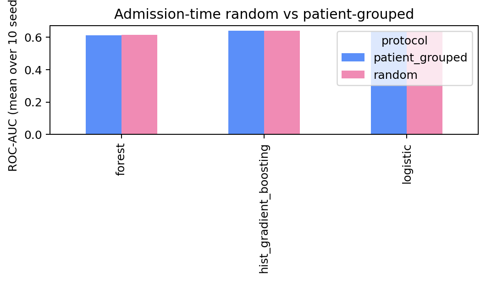

# Diabetes 130-US Hospitals real-world case study

The raw file contains 101,766 encounters and 50 source columns. SHA-256: `0689e7ec031237dc63031b938805c48377748761a3b26acab621567afa24df97`. The binary target is 1 when `readmitted == '<30'`, and 0 for `'>30'` or `'NO'`; this is an operational 30-day target, not a claim that the two negative categories are clinically identical.

## Prediction-time policies

Primary models exclude `encounter_id` and `patient_nbr`; `patient_nbr` is only a grouping variable. Admission-time models exclude discharge disposition, stay/procedure/medication utilization, lab-result fields, medication/change fields, `diag_2`, `diag_3`, and `number_diagnoses`. The distributed data do not establish those secondary diagnoses or final count as known at admission. Discharge-time models retain non-identifier source features.

## Executed evidence

Ten seeds (42–51) were run for random row splits and patient-grouped splits across both policies and five model families. Random splits had approximately 8,069 overlapping patients on average; grouped splits had zero overlap for every seed. This is protocol sensitivity, not causal leakage inflation.

## Corrected duplicate findings

Duplicate comparisons use each scenario's actual predictive features and exclude `encounter_id`, `patient_nbr`, `readmitted`, and the derived target. Admission-time exact duplicates: 31719 rows in 9037 groups. Discharge-time exact duplicates: 0 rows in 0 groups. Near-duplicate candidate rows: admission 31030; discharge 0. These candidates use LeakageLens's rounded/normalized equality definition and are heuristic, not general similarity scores.

Per-seed train/test predictive-feature overlap is preserved in `duplicate_and_detector_summary.json`. Exact duplicates, near-duplicate candidates, patient overlap, and suspicious-feature warnings are reported separately.

## Other limitations

No temporal result is claimed because the dataset has no defensible admission timestamp. The full duplicate/near-duplicate and controlled-validation outputs are in `validation/real_world/diabetes_130/results/run_20261113T122123Z`. Figures are generated from the same run's CSV/JSON artifacts.

## Provenance

Committed Git SHA: `e686f1a88329addf544b8cd31caff12a12f9d7b9`. Experiment script SHA-256: `67ae0b050f8658809a35ad9d36195da3be1efe5ee1dd37a39400104c4f3eb5ac`. Dependency versions are in `run_metadata.json`.
